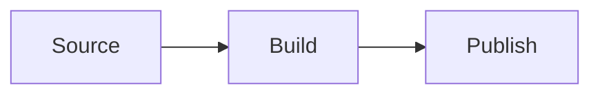

# The Deterministic Boundary

A statically generated independent publication built with [Astro](https://astro.build/) and deployed to [GitHub Pages](https://pages.github.com/).

## Local development

The project requires Node.js 22.23.4 or newer and npm. The expected version is recorded in `.nvmrc`.

```bash
nvm use
npm install
npm run dev
```

Astro serves the development site at `http://localhost:4321` by default.

Available commands:

| Command | Purpose |
| --- | --- |
| `npm run dev` | Start the local development server |
| `npm run check` | Validate Astro components and TypeScript |
| `npm run build` | Generate the production site in `dist/` |
| `npm run preview` | Serve the generated production site locally |

Use `npm ci` instead of `npm install` in automated or reproducible environments.

## Publishing an article

Create a `.md` or `.mdx` file in `src/content/blog/`. Its filename becomes the URL slug, so `knowledge-and-intelligence.md` is published at `/blog/knowledge-and-intelligence/`.

Every article starts with validated frontmatter:

```yaml
---
title: "Knowledge and Intelligence"
description: "A concise description used in listings and search metadata."
pubDate: 2026-11-22
updatedDate: 2026-11-23
tags:
  - knowledge
  - intelligence
draft: false
---
```

`updatedDate`, `tags`, and `draft` are optional. Dates use the `YYYY-MM-DD` format. The schema is defined in `src/content.config.ts`.

Run `npm run check` and `npm run build` before publishing. A push to `main` starts the deployment workflow.

## Writing features

### Code

Use standard fenced code blocks with a language name:

````markdown
```python
def answer() -> int:
    return 42
```
````

Shiki provides build-time highlighting. Python, TypeScript, JavaScript, SQL, Cypher, Bash, YAML, and JSON are configured explicitly. Rendered blocks include a copy button.

### Mermaid

Mermaid diagrams are written directly in fenced blocks:

````markdown

````

Diagrams render as responsive SVGs in the browser and follow the active color theme. Include Mermaid `accTitle` and `accDescr` directives so the diagram has a useful accessible description.

### LaTeX

Use `$...$` for inline mathematics and `$$...$$` for display equations:

```markdown
The identity $E = mc^2$ is inline.

$$
H(X) = -\sum_i p(x_i) \log_2 p(x_i)
$$
```

KaTeX renders equations during the Astro build.

### Internal links

Root-relative links keep references stable:

```markdown
Read the [About page](/about/) or another [article](/blog/article-slug/).
```

## Drafts

Set `draft: true` in an article's frontmatter to keep it out of production article pages, listings, RSS, and sitemap output. Drafts remain visible during local development so they can be reviewed with `npm run dev`.

Always run a production build before publishing to confirm that draft routes are excluded.

## Site configuration

Edit `src/config.ts` to change the publication title, tagline, author pseudonym, social preview image, or profile links. The pseudonymous GitHub profile is configured there. Do not add personal profile links or identifying biographical details.

The canonical production URL is configured in `astro.config.mjs`. Because this is the `dimpac.github.io` user site, it intentionally has no project base path.

Global styles and theme variables live in `src/styles/global.css`. The default social card source is `public/og-source.svg`, and the generated sharing asset is `public/og-default.png`.

## Deployment

`.github/workflows/deploy.yml` builds and deploys the static site whenever a commit is pushed to `main`. It can also be started manually from the Actions tab. The workflow installs the lockfile with `npm ci`, builds `dist/`, uploads the Pages artifact, and deploys it with the official GitHub Pages actions.

One repository setting must be configured manually:

1. Open **Settings** in the GitHub repository.
2. Select **Pages**.
3. Under **Build and deployment**, set **Source** to **GitHub Actions**.

The deployed site is available at <https://dimpac.github.io/>. Its RSS feed is `/rss.xml`, and the sitemap integration generates `/sitemap-index.xml`.
