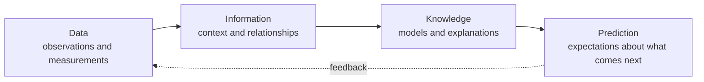

Humans have always had different ideas about intelligence. Yet we've been remarkably comfortable placing ourselves at the top of the animal kingdom. We tend to dismiss other forms of carbon-based intelligence, whether dogs, birds or other animals, not simply as inferior, but as incomplete versions of our own. As though human intelligence were the final expression of what intelligence should be.

But what exactly makes us intelligent?

One way to look at intelligence is as the capacity to transform and transfer information. Alongside that comes knowledge: information structured in a way that allows an intelligence to make sense of it. For a long time, we considered this combination something that set humans apart from the rest of the animal kingdom.

Knowledge itself can be understood as a progression. We start with data: bits, bytes, tokens, measurements. Pieces that mean very little on their own. Once organised and given context, they become information. Relationships emerge, patterns become recognisable, and those patterns can guide behaviour.

Animals do this remarkably well. They recognise threats, find food, navigate their environments and learn from experience. But humans have taken this further, developing formal knowledge: mathematical theorems, scientific explanations, proofs and entirely new concepts. This resembles the familiar Data–Information–Knowledge hierarchy, although the boundaries between these stages are hardly as neat as the diagram suggests.

What made this progression particularly powerful was our ability to accumulate knowledge.

Humans have always learned from one another, but writing changed the scale of that exchange. Knowledge no longer needed to disappear with the person who possessed it. Ideas could survive generations, travel across continents and become the foundations for discoveries their original authors could never have imagined.

<figure>
  
  <figcaption>
    Writing allowed information to outlive its author. Precuneiform clay tablet, Louvre AO 29562. Photograph by <a href="https://commons.wikimedia.org/wiki/File:Clay_Tablet_-_Louvre_-_AO29562.jpg">Poulpy via Wikimedia Commons</a>, public domain.
  </figcaption>
</figure>

And this process became recursive. New knowledge was built upon existing knowledge, refined, challenged and extended.

Eventually, knowledge became something that could exist independently of the individual who produced it.

One of the most powerful tools we developed for expanding that knowledge was the scientific method. It has been extraordinarily successful, but I wonder whether we sometimes treat it as the final method of acquiring knowledge rather than the best one we've developed so far.

Science relies on observation, experimentation and evidence. Instruments have extended our senses far beyond their biological limits. Yet we still need to make phenomena observable, measurable or otherwise testable within a framework we can understand.

That doesn't make the scientific method wrong. But does it make it complete?

I don't know. And I don't think we know what a successor, or even a complementary method, would look like.

Now silicon-based intelligence enters the picture.

These systems are climbing parts of the same knowledge ladder, but at a very different speed. They inherit enormous amounts of human knowledge through their training data, yet increasingly demonstrate an ability to generalise, combine concepts and contribute to new discoveries.

And suddenly, some of our traditional markers of intelligence don't look particularly human anymore.

Chess is the obvious example. For centuries, being an exceptional chess player was associated with extraordinary intelligence. Today, no human can consistently beat a top chess engine. Kasparov's defeat by Deep Blue was a turning point, even if the machine relied heavily on computation rather than anything resembling human reasoning.

<figure class="figure-narrow">
  
  <figcaption>
    A Deep Blue system at the Computer History Museum. Photograph by <a href="https://commons.wikimedia.org/wiki/File:Deep_Blue.jpg">James the photographer via Wikimedia Commons</a>, licensed under <a href="https://creativecommons.org/licenses/by/2.0/">CC BY 2.0</a>.
  </figcaption>
</figure>

Mathematics is another. AI systems are increasingly solving difficult mathematical problems and contributing to research that would once have required substantial human effort. Recent claims of breakthroughs, including a purported AI-assisted proof of the Riemann Hypothesis, are fascinating, although they deserve careful scrutiny before we draw sweeping conclusions about machine intelligence.

So if possessing knowledge, performing calculations or mastering complex games no longer distinguishes us, what does?

One interesting alternative is prediction.

We often associate intelligence with success, but the relationship is far from straightforward. Plenty of knowledgeable people achieve very little, while others with relatively modest formal knowledge make remarkably good decisions.

Perhaps what matters is not how much knowledge someone possesses, but how effectively they use it to anticipate what comes next.

## The curious case of the superforecasters

Having now read Philip Tetlock's *Superforecasting*, I find his research particularly relevant here.

Tetlock spent years studying the ability of experts to predict political, economic and geopolitical events. His findings challenged a comfortable assumption: that greater intelligence, deeper knowledge or impressive academic credentials should naturally produce better forecasts.

The relationship turned out to be considerably less straightforward.

An expert might understand everything about a country's history and political institutions, yet struggle to predict its next crisis. Worse, expertise can sometimes make us better at defending our existing beliefs rather than challenging them.

Being knowledgeable can make us better at reasoning. It can also make us better at rationalising.

Tetlock's Good Judgment Project took a different approach. Thousands of participants made predictions about real-world events, assigning probabilities to outcomes that could eventually be verified.

Instead of rewarding compelling explanations, the project measured predictive accuracy.

And among those participants emerged an unusually successful group: the superforecasters.

They weren't necessarily people with extraordinary academic qualifications or privileged information. They tended to break complicated problems into smaller ones, consider historical base rates, examine competing explanations and update their beliefs when new evidence appeared.

Perhaps most importantly, they were comfortable being uncertain.

A superforecaster might assign a 65% probability to an event rather than declare that it will happen. When new information emerges, that estimate changes.

This isn't indecision. It's recognising that uncertainty is part of the problem rather than something to conceal behind a confident narrative.

Tetlock's research also suggests that forecasting can improve through practice, feedback and disciplined thinking. Intelligence and expertise matter, but neither guarantees predictive accuracy.

Of course, even excellent forecasters are sometimes wrong. A genuinely unlikely event can still happen.

But this raises an interesting question.

If accurate forecasting depends on recognising patterns, learning from feedback and adjusting our expectations, what exactly are we measuring when we call someone intelligent?

And how different is that from the way we train artificial intelligence?

## Prediction is not understanding

There's a complication.

Prediction isn't the same as intelligence, and intelligence isn't necessarily the same as successful action.

A system might forecast an event accurately without understanding how to respond to it. Another might produce a less accurate prediction but develop a plan that leads to a better outcome.

There's also a difference between predicting something and understanding why it happens.

A sufficiently sophisticated system might learn to predict physical phenomena without possessing the scientific theories humans use to explain them. It may recognise useful relationships without being able to express them in terms we find intuitive.

And this is where the differences between carbon and silicon intelligence become particularly interesting.

Silicon systems can be extraordinarily capable, yet their reliability becomes harder to establish when information is incomplete, contradictory or unfamiliar.

Humans aren't particularly consistent either. We make assumptions, misinterpret evidence and confidently predict things that never happen. Yet we navigate ambiguous situations using experience, context and an understanding of the physical and social world that is difficult to reduce to a dataset.

Neil Lawrence explores some of these distinctions in *The Atomic Human*, particularly the role of embodiment and the different constraints under which human and machine intelligence operate.

Whether these differences represent fundamental boundaries or simply the current state of technology is another question.

But before deciding whether silicon will eventually become more intelligent than carbon, I think we need to revisit the question we started with.

What exactly makes us intelligent?

We've traditionally associated intelligence with reasoning, knowledge, understanding and the ability to anticipate the future.

Yet machines are increasingly demonstrating capabilities in each of these areas, sometimes through processes remarkably different from our own.

Perhaps the mistake is assuming that intelligence must look like human thought.

Or perhaps we're making an even more fundamental mistake.

**What if intelligence isn't what we think it is?**

**What if intelligence is, at its core, an extraordinarily sophisticated form of pattern detection?**

And if that's the case, what really separates understanding the world from becoming exceptionally good at predicting it?
